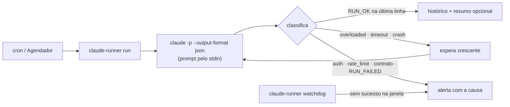

# claude-headless-runner

Rotinas `claude -p` agendadas que **nunca falham em silêncio**.
Contrato de saída, retry só no que é transitório, alerta com a causa em português simples e um vigia
que avisa quando a rotina simplesmente parou de rodar. Python, sem nenhuma dependência.

## O problema

Colocar `claude -p "..."` num cron é fácil. Difícil é saber quando deu errado:

- o login venceu, o limite de uso estourou ou a API ficou instável, e o cron só registra "exit 1" num log que ninguém lê;
- o modelo respondeu, o processo saiu com 0, mas a tarefa **não foi feita**;
- a máquina ficou desligada ou alguém desativou a tarefa no agendador, e nada avisa, porque nada rodou.

## A solução



- **Contrato de saída.** O prompt termina com `RUN_OK` ou `RUN_FAILED: motivo` na última linha. Sem isso, a rotina é falha, mesmo com exit 0.
- **Erros separados por tipo.** Login (`auth`), limite de uso (`rate_limit`), API instável (`overloaded`), `timeout`, `max_turns`, `crash`, `setup` (claude não instalado) e `overlap` (execução anterior ainda rodando).
- **Retry só no transitório.** Por padrão `overloaded`, `timeout` e `crash`, com espera crescente. Login vencido não melhora tentando de novo: alerta na hora.
- **Timeout que mata a árvore de processos** (o `claude` roda em Node e pode deixar filhos órfãos).
- **Uma execução por vez** (trava com detecção de processo morto) e histórico JSONL por rotina, com custo e ID da sessão.
- **Alerta** por webhook (Slack, Discord ou ntfy) com mensagem humana: *"o login do Claude venceu ou é inválido; abra `claude` na máquina da rotina e faça /login"*. Sem webhook, o alerta vai para o stderr e o código de saída é diferente de 0.
- **Vigia** (`watchdog`): avisa se a rotina passou da janela esperada sem sucesso, só em horário comercial, uma vez por período, com lembrete a cada 24h.
- **Agendamento sem mágica.** `claude-runner schedule` imprime a linha do crontab e o comando `schtasks`; você revisa e registra.

## Exemplos

### `metrics-watchdog`: o LLM orquestra, o Python decide

[`examples/metrics-watchdog`](examples/metrics-watchdog): conferência diária de métricas contra uma fonte de verdade (dados sintéticos).
O [script determinístico](examples/metrics-watchdog/check_metrics.py) calcula o dia útil anterior, separa o **dono** de cada métrica
("a rotina pode preencher" × "avisar o dono"), aponta vazios, divergências acima da tolerância e textos diferentes (comparados por hash, sem expor o conteúdo).
O Claude só roda o script e escreve o resumo. Saída real (Claude Code 2.1, Haiku, 8,7 s, US$ 0,0045):

```text
Data de referência: 2026-11-06
OK: new_signups.
Vazio, a rotina pode preencher com o valor da fonte: support_tickets = 44 (dono: routine).
Vazio, avisar o dono: churned_accounts (dono: pipeline; sem valor de fonte disponível).
Diverge da fonte: active_users = 1915 contra 1960 na fonte, diferença de 2.3% (dono: pipeline).
Divergência em campo de texto, avisar o dono: nps_comment (dono: pipeline).
metrics-watchdog: OK · 8.7s · US$ 0.0045 · RUN_OK
```

**Com o [claude-code-policy-guard](https://github.com/reanto-afk/claude-code-policy-guard)** como hook, a rotina só consegue ler arquivos e rodar o script.
Todo o resto é bloqueado e fica na trilha de auditoria ([política](examples/metrics-watchdog/.claude/policy-guard.toml)):

```bash
pip install "git+https://github.com/reanto-afk/claude-code-policy-guard"
cd examples/metrics-watchdog && policy-guard install && cd ../..
claude-runner run examples/metrics-watchdog/routine.toml
```

### `weekly-status`: rascunho para aprovação humana

[`examples/weekly-status`](examples/weekly-status): toda sexta, lê o que aconteceu na semana e manda um rascunho de status (Entregue / Em andamento / Riscos) para o canal de aprovação. Ninguém publica nada sem revisar.

### Quando dá errado

Rotina cujo prompt esquece o contrato, com o alerta capturado num webhook:

```text
$ claude-runner run routine.toml
falha-de-contrato: FALHOU (contract) · 3.3s · a rotina terminou sem RUN_OK / RUN_FAILED na última linha (última linha: 'olá'); revise o prompt

webhook recebeu: {"text": "[falha-de-contrato] FALHOU\na rotina terminou sem RUN_OK / RUN_FAILED na última linha ..."}

$ claude-runner status . examples
rotina              último    quando                     último sucesso             custo
falha-de-contrato   contract  2026-11-09T14:24:16-04:00  -                          0.002586
metrics-watchdog    ok        2026-11-09T14:23:52-04:00  2026-11-09T14:23:52-04:00  0.00451
weekly-status       ok        2026-11-09T14:24:00-04:00  2026-11-09T14:24:00-04:00  0.004495
```

## Como usar

```bash
pip install "git+https://github.com/reanto-afk/claude-headless-runner"
export CLAUDE_RUNNER_WEBHOOK="https://hooks.slack.com/services/..."   # Windows: setx CLAUDE_RUNNER_WEBHOOK "..."

claude-runner run minha-rotina/routine.toml --dry-run    # mostra o comando, não roda
claude-runner run minha-rotina/routine.toml
claude-runner schedule minha-rotina/routine.toml         # imprime crontab e schtasks
claude-runner watchdog .                                 # agende de hora em hora
claude-runner status .
claude-runner history minha-rotina/routine.toml -n 10
```

### `routine.toml`

```toml
name = "minha-rotina"                 # minúsculas, números e hífen
prompt_file = "prompt.md"             # vai pelo stdin; termine pedindo RUN_OK / RUN_FAILED: motivo
cwd = "."                             # pasta onde o claude roda (relativa a este arquivo)
model = "haiku"
allowed_tools = ["Read", "Bash(python check.py:*)"]
extra_args = ["--setting-sources", "project"]
timeout_seconds = 600
max_attempts = 2
backoff_seconds = [30]
retry_on = ["overloaded", "timeout", "crash"]
daily_at = "07:30"                    # ou weekly_at = "FRI 16:00" ou every_minutes = 30
expect_every_hours = 24               # janela do vigia
business_hours = "8-18"               # o vigia só avisa nesse horário

[alert]
webhook_env = "CLAUDE_RUNNER_WEBHOOK" # nome da variável; a URL nunca fica no arquivo
format = "slack"                      # slack | discord | ntfy
notify_on_success = false             # true: manda o texto da resposta (sem a linha RUN_OK)
```

Variáveis: `CLAUDE_RUNNER_WEBHOOK` (padrão do alerta), `CLAUDE_RUNNER_STATE` (pasta de estado; padrão `.runner-state/` ao lado da rotina) e `CLAUDE_RUNNER_CLAUDE_BIN` (outro executável do claude).

## Decisões de design

- **Contrato na última linha em vez de confiar no exit code.** `claude -p` sai com 0 sempre que o modelo responde; quem sabe se a tarefa foi feita é a rotina.
- **Prompt pelo stdin.** Evita limite e escaping de linha de comando no Windows e deixa `--allowedTools` (opção variádica) por último.
- **Classificação por campos do JSON** (`is_error`, `subtype`, `api_error_status`) e, sem JSON, por pistas no stderr. As pistas ficam em [`claude.py`](claude_runner/claude.py), fáceis de ajustar.
- **O runner não registra tarefa no SO.** Gerar o comando e deixar a pessoa registrar é mais seguro e mais fácil de auditar.
- **Determinístico onde dá.** No exemplo de métricas, regra de negócio (dia útil, dono, tolerância, hash de texto) é Python testável; o LLM resume.

## Limites

- A classificação depende das mensagens do Claude Code (testado na 2.1). Mudou o texto de erro, pode cair em `crash`: o alerta sai do mesmo jeito, só com rótulo menos preciso.
- O vigia precisa ser agendado também, de preferência fora da máquina da rotina se a ideia é pegar "máquina desligada".
- `.runner-state/` guarda o texto das respostas: mantenha fora do git (já está no `.gitignore`).
- Próximos passos (v2): fila de eventos idempotente, um turno por evento na mesma sessão (`--resume`), cursor que só avança e retomada de ciclo cortado.

## Testes

```bash
pip install -e ".[dev]" && pytest
```

55 testes offline com um [`claude` falso](tests/fake_claude.py) que simula sucesso, contrato quebrado, login vencido, limite, API instável, timeout, crash e instabilidade seguida de sucesso, sem gastar tokens.

## Licença

MIT
